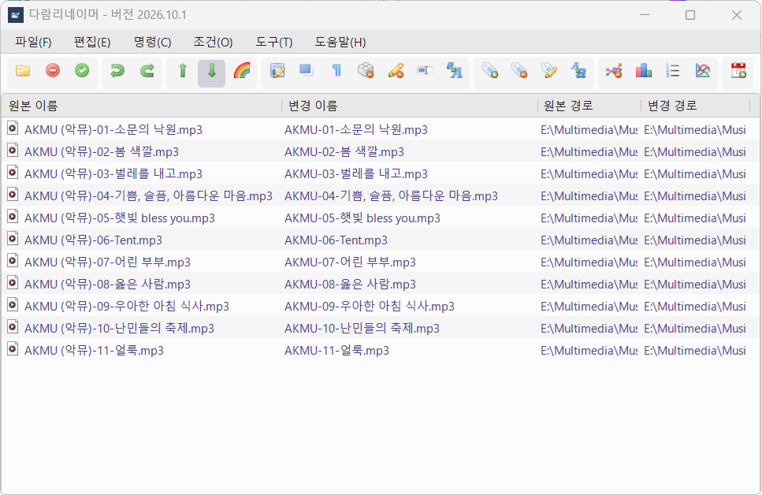

# 다람리네이머
`다람리네이머`는 파일 이름을 일괄적으로 변경하는 응용프로그램입니다.

## 요구사항
- `.NET 10.0`
- `Windows 11 26H2` 이상

# DaramRenamer
`DaramRenamer` is application program for batched filename change.

## Requirements
- `.NET 10.0`
- `Windows 11 26H2` or newer

----
## 스크린샷 (Screenshots)

